# Domino × Hunch

Domino is a next-day world model, built at the Gemini 4 Argon hackathon (2026-10-25) on top of Hunch's NEXTDAY benchmark and data collectors.
- **Approach:** statistical "first-domino" models, Google's TimesFM 3.0, and Gemini 4 Argon (thinking `high`, priority tier), each scored on outcomes.
- **This folder:**
  - Domino's code and the analyses of Hunch's benchmark.
  - A real estate world model and investment screen fed by Hunch's collectors.
  - The 3D dashboards.

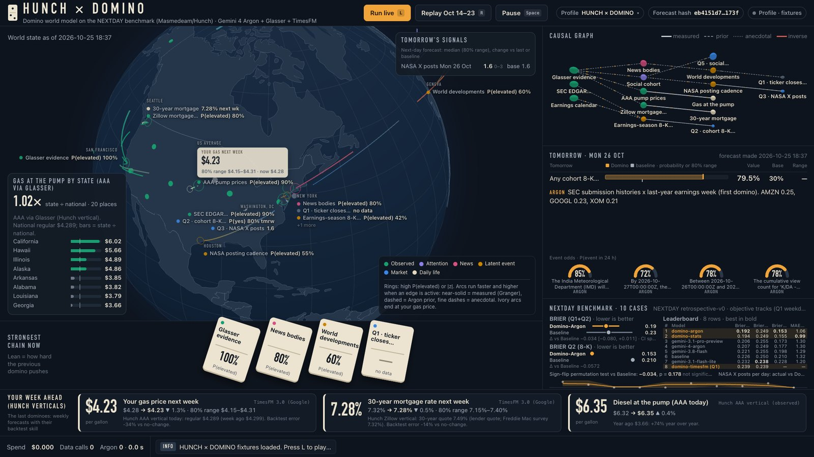

Everything here is self-contained; nothing outside `integrations/domino/` changes.

## View the dashboards (no keys needed)

```bash
cd integrations/domino
python -m venv .venv && .venv/bin/pip install -r requirements.txt
.venv/bin/python -m uvicorn domino.server:app --port 8100
```

The dashboards run from prebuilt fixtures in `domino/static/profiles/`. Press 1–9, or use the header dropdown, to switch between them.

| URL | What it shows |
|---|---|
| `/?profile=hunch` | Hunch's world as dominoes, the rescored leaderboard, Monday's forecasts, gas prices by state |
| `/?profile=hunch-world` | Q4: every model's world claims resolved on outcomes; judge vs. outcome; Monday's head-to-head |
| `/?profile=hunch-social` | Q3 + Q5 + YouTube: posting cadence, view-velocity forecast vs. Hunch's pilot, social-data audit |
| `/?profile=hunch-markets` | Q1 + Q2: per-company 8-K odds (earnings calendar as the first domino), META brackets |
| `/?profile=hunch-life` | Hunch's verticals: pump, EV charging, mortgage, rent, used cars, insider ratios |
| `/?profile=daily-life` | Week-ahead gas, mortgage and flu, backtested against no-change |
| `/?profile=categories` | 8-category sweep: what is predictable next day, and the first dominoes |
| `/realestate` | Real estate: where to invest over the next 12 months (USD), measured chains, scoreboard |
| `/realestate/mock?v=1`, `?v=2`, `?v=3` | Three simplified layouts built on the globe and causal links: map-first, linked views, causal flow |
| `/realestate/mock?v=1&theme=white`, `&theme=offwhite` | White and off-white versions of the same mocks (also `v=2`, `v=3`; the header switch toggles dark · white · off-white) |
| `/?mock=1` | The live Domino page (Hormuz → oil → your pump) on demo fixtures |

| | |
|---|---|
| 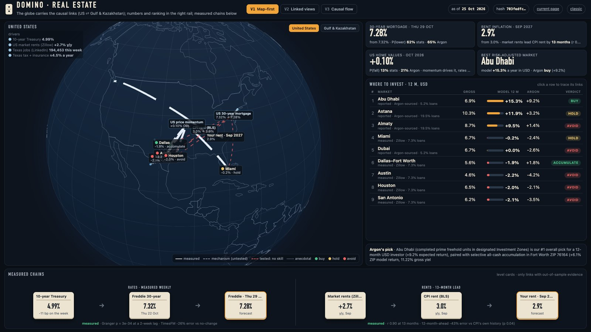 | 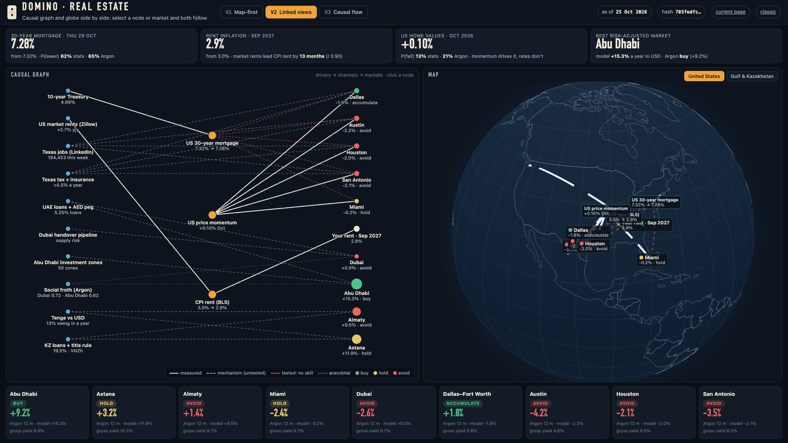 |
| 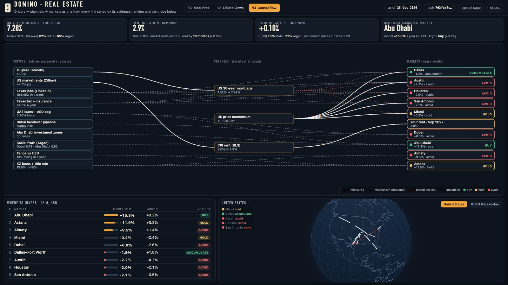 | 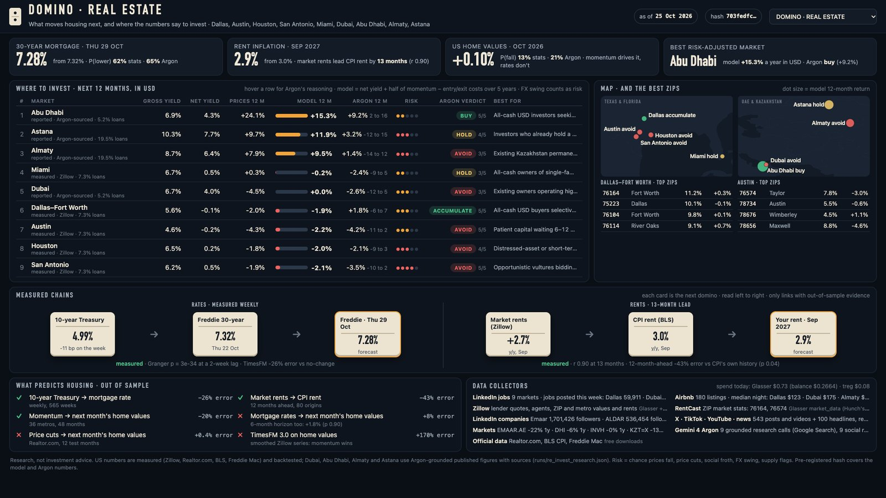 |

### White and off-white versions

| | White (`&theme=white`) | Off-white (`&theme=offwhite`) |
|---|---|---|
| V1 · Map-first | 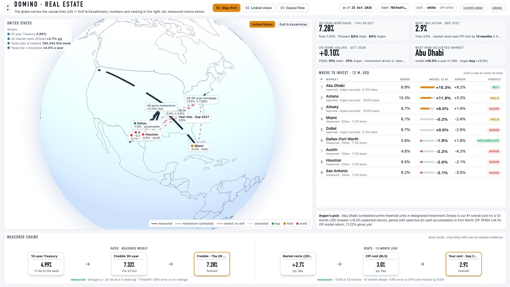 | 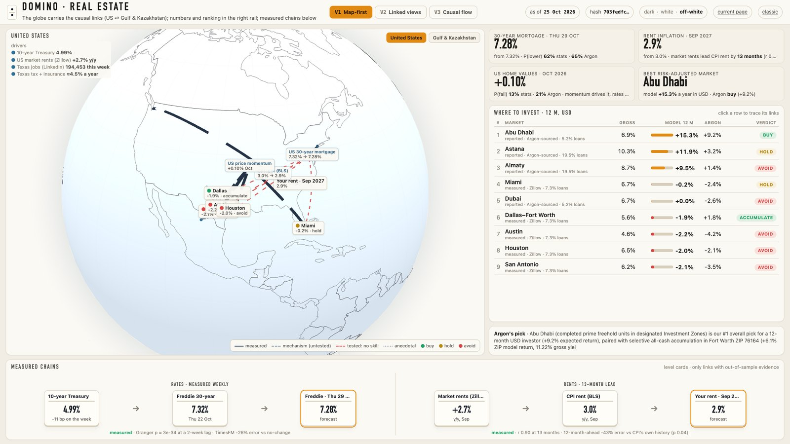 |
| V2 · Linked views | 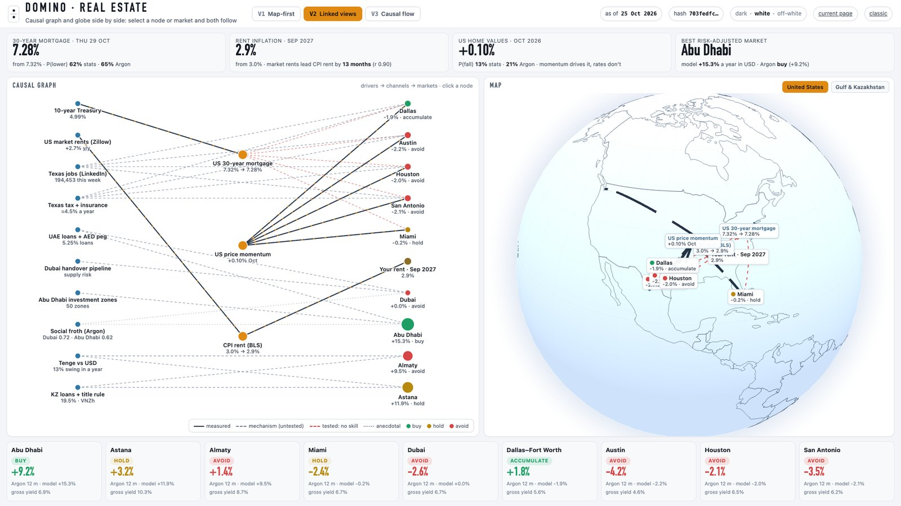 | 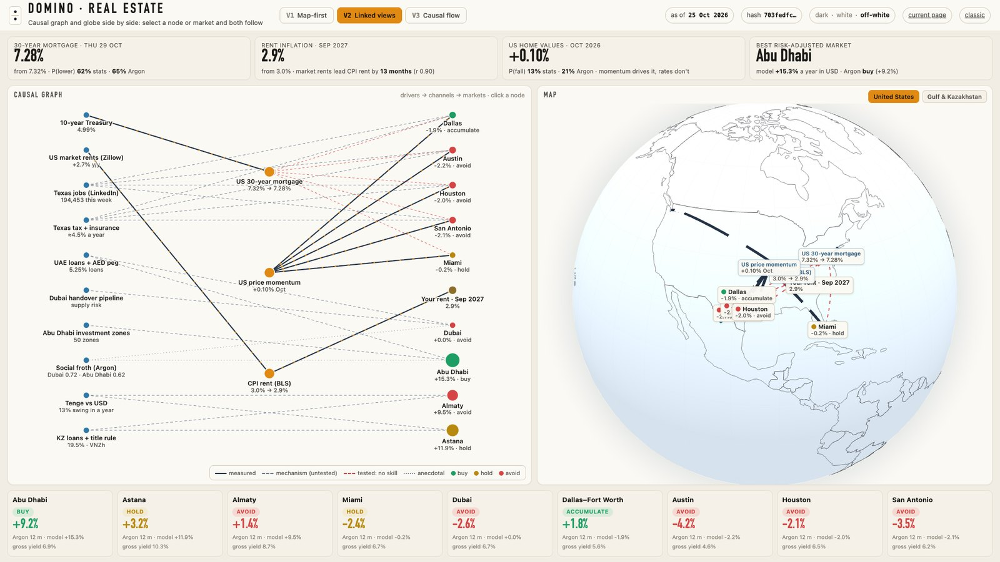 |
| V3 · Causal flow | 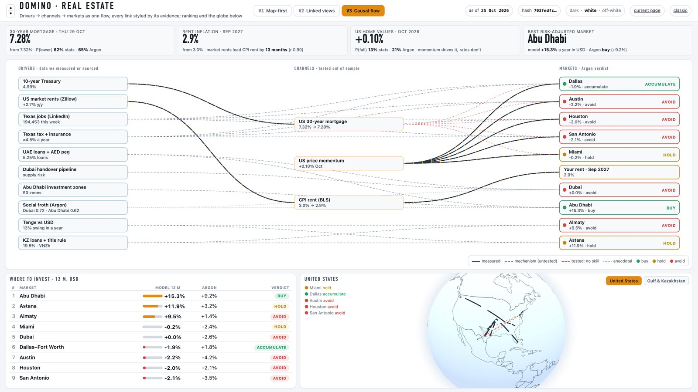 | 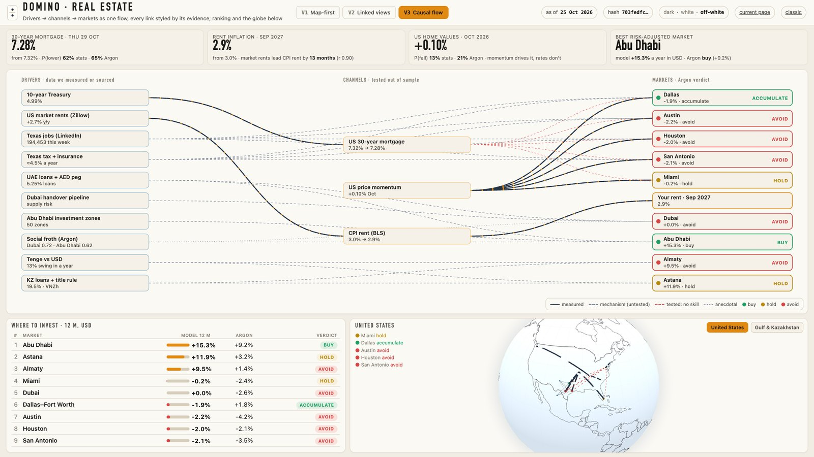 |

## Re-run the analyses

```bash
cp .env.example .env              # GOOGLE_API_KEY (Argon), TREG_TO (treg.to), GLASSER (Glasser)
scripts/get_bundle.sh             # Hunch's bundle → external/hunch_live/bundle.json (local export if present, else the live worker)
.venv/bin/python -m domino.hunch_analysis          # Q1–Q3 rescoring, stats + Argon entries, bootstrap CIs, permutation test
.venv/bin/python -m domino.hunch_extended resolve  # Argon resolves every Q4/Q5 claim against held-out evidence
.venv/bin/python -m domino.hunch_extended score
.venv/bin/python -m domino.hunch_extended pilot    # pre-registered head-to-head with Hunch's Argon pilot (live data)
.venv/bin/python -I domino/realestate.py stats     # Treasury → mortgage, rents → CPI rent, metro home values
.venv/bin/python -I domino/realestate_invest.py collect && \
  .venv/bin/python -I domino/realestate_invest.py research && \
  .venv/bin/python -I domino/realestate_invest.py social && \
  .venv/bin/python -I domino/realestate_invest.py zips && \
  .venv/bin/python -I domino/realestate_invest.py rank
.venv/bin/python -I domino/profiles_build.py       # rebuild every dashboard profile
```

**Optional TimesFM 3.0 comparisons:** these run in a separate venv with `timesfm` 3.0.x and torch, e.g. `domino/sota_timesfm.py` and `domino/hunch_timesfm.py`. The weights are licensed non-commercial and are not included.

**Spend limits:**
- `domino/treg_client.py` caps treg at $0.03 per call and $0.40 per session.
- `domino/glasser_client.py` caps Glasser at $0.15 per run and $0.90 per session.
- Every response is written to a local cassette, so a re-run replays it instead of paying twice.

## What we found

**1. Rescored on outcomes** (10 cases, 17 yes/no questions; Brier and MAE, lower is better)

| Model | Brier Q1 + Q2 | Brier Q2 (8-K) | MAE Q3 (NASA posts) |
|---|---|---|---|
| domino-argon (Argon with Domino's evidence) | **0.192** | **0.153** | 1.07 |
| domino-stats (no LLM) | 0.194 | 0.155 | **0.99** |
| gemini-3.1-pro-preview | 0.206 | 0.173 | 1.30 |
| gemini-4-argon | 0.207 | 0.177 | 1.30 |
| gemini-3.8-flash | 0.221 | 0.198 | 1.29 |
| Hunch baseline | 0.226 | 0.210 | 1.32 |
| gemini-3.1-flash-lite | 0.232 | 0.228 | 1.20 |

For the Q2 8-K question, the first domino is the earnings calendar: SEC filing histories combined with last year's earnings week.
- **Significance:** with n = 10 the edge is not significant (sign-flip permutation p = 0.18).
- **Weekends:** Q2 hides an artifact. It almost never resolves yes on weekends, so a weekday/weekend split matters.

**2. Q4/Q5 narrative claims, resolved by Argon** against the held-out evidence (`domino/hunch_extended.py`)

| Measure | Result |
|---|---|
| Claims resolved | 199: 64 yes, 16 no, 119 unresolved (unmentioned ≠ false, per Hunch's own rule) |
| Hunch's judge score vs. outcome Brier | Spearman **−0.05** (p = 0.72) |
| Hunch's judge score vs. claim specificity | Spearman **+0.50** (p = 0.0002) |
| Claims continuing a running story | 85 (87% came true) |
| Claims about scheduled events | 22 (86% came true) |
| Claims calling a genuinely new event | **1** |

The judge rewards claims that sound specific, not claims that come true.

**3. Pilot head-to-head for 2026-10-26, pre-registered** (hash `a5118015…`, `runs/hunch_pilot_domino.json` when re-run)

| Pilot forecast | Hunch (Argon) | Domino |
|---|---|---|
| IMD Bay of Bengal cyclone | 0.85 | 0.86 |
| UK homes without power below 25k | 0.72 | 0.73 |
| META down / flat / up | 0.35 / 0.45 / 0.20 | 0.28 / 0.45 / 0.28 |
| No US embassy departure and no US strike in Iran | 0.78 | 0.89 |
| K/DA video reaches 26.85M views | 0.78 | **0.99** |

On the K/DA call, Domino measured about 97k views an hour, and the threshold had already been crossed when it forecast.

**4. Social data audit (Argon)**
- **Freshness:** 70% of observations are within 7 days, and all 462 TikTok trend points are older than 7 days.
- **Regions:** region tags are what was requested, not verified audience.
- **Counters:** these are lifetime totals with sparse repeat observations. Next-day engagement is forecastable only for items that are observed twice.

**5. Real estate** (`analysis/real_estate_analysis.md`, `analysis/real_estate_investments.md`)

What predicts housing, out of sample:

| Link | Result |
|---|---|
| 10-year Treasury → 30-year mortgage | Granger p = 3e-34 at a 2-week lag; TimesFM −26% error vs. no-change |
| Market rents → CPI rent | 13-month lead, r = 0.90; 12-month-ahead forecast −43% error vs. CPI's own history (p = 0.04) |
| Mortgage rates or price cuts → home values | No added next-month skill; momentum drives home values |

Investment screen, run with every Hunch collector (Zillow, RentCast, Airbnb, LinkedIn, Wellfound, X/TikTok/YouTube, news) plus grounded Argon research, for a 12-month USD view:

| Market | Verdict (Argon, 5 samples) | Detail |
|---|---|---|
| Abu Dhabi | **buy** (5/5) | +9.2% [1.5, 16] |
| Dallas–Fort Worth | **accumulate** (5/5) | selected ZIPs only, e.g. 76164: 11.2% gross yield, rentals lease in a median 4 days |
| Austin, Houston, San Antonio, Dubai, Almaty | avoid | |
| Astana, Miami | hold | |

The transparent model and Argon's ranking agree (Spearman 0.73, p = 0.025; hash `703fedfc…`). This is research, not investment advice.

## Layout

```
domino/                 Python package: Hunch analyses, real estate, live pipeline, collectors, FastAPI server
domino/static/          index.html (profiles), realestate.html, realestate_mock.html, vendored Globe.gl + 3d-force-graph, fixtures, profiles
rpwm/argon.py           Gemini 4 Argon client (Interactions API, thinking high, priority tier, cache + ledger)
rpwm/core.py            exact discrete Bayes / free-energy helpers used by the live pipeline
tools/                  treg.sh, glasser.sh (read keys from .env, never print them), argon_usage_report.py
analysis/               write-ups: Hunch × Domino, real estate, categories, daily life
docs/                   ARGON_USAGE.md (how Domino uses Argon, for judges and investors; every call logged), GEMINI_ARGON_SETUP.md,
                        HACKATHON_PROJECT_DESCRIPTION.md (submission text), PROJECT_HQ_LOCATOR.md (HQ use case), screenshots
scripts/get_bundle.sh   fetch Hunch's bundle for the analyses
```

**Run outputs** (`runs/`), **downloads** (`data/`) and the **bundle copy** (`external/`) are created locally and gitignored.

## Data and licenses

- **Data used for the analyses** (not redistributed here): Zillow research data (ZHVI, ZORI), Realtor.com research data, BLS CPI, Freddie Mac PMMS, Yahoo Finance prices, SEC EDGAR.
- **Collectors:** live calls go through treg.to and Glasser.
- **Vendored libraries:** Globe.gl and 3d-force-graph (MIT), Natural Earth 1:110m countries (public domain).
- **TimesFM 3.0 weights:** Google, non-commercial license; not included.
